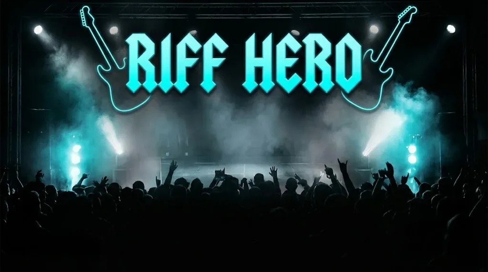

# Riff Hero

> **This version is on hold. I'm planning a remake from scratch.**

A rhythm game like Guitar Hero where you can play your own songs. I love rhythm games, and in all of them someone else picks the songs. Notes come down five lanes, played with A, D, J, K and L, and every hit or miss moves the score.

## How it works

The hard part is turning a song into notes. My first script listened to the audio with librosa and tried to find the notes in it, and the results weren't reliable, so I switched to MIDI files.

`src/main/python/loadsong.py` reads a MIDI file with Mido and scores every track by how many notes it has, how wide its range is and how high it sits. That skips the drums and the bass and finds the melody. It then converts that track to JSON, with each note's time in seconds worked out from the song's tempo changes.

The game reads that JSON. It's written in Java with FXGL, a game engine built on JavaFX, and handles the lanes, the falling notes, hit detection, the score and the menus.

## Why it's on hold

Even with the right notes, the music drifted away from the notes on screen, and I couldn't find why. That's where I stopped.

## The remake

A rhythm game where I can play any song is something I still want to make, so I'm going to start over rather than keep fixing this version. It'll probably be in Unity this time. I only used Java and FXGL because Java was what we were learning at university then. This repository stays up as the first attempt.

## Repository note

The songs' audio files aren't in the repository, so the game has nothing to play as it is. The code is here to read.

## Built with

- Java 21 and FXGL
- Python and Mido, for the MIDI parsing
- Maven

## Author

[Diogo Ferreira](https://diogof146.com)
